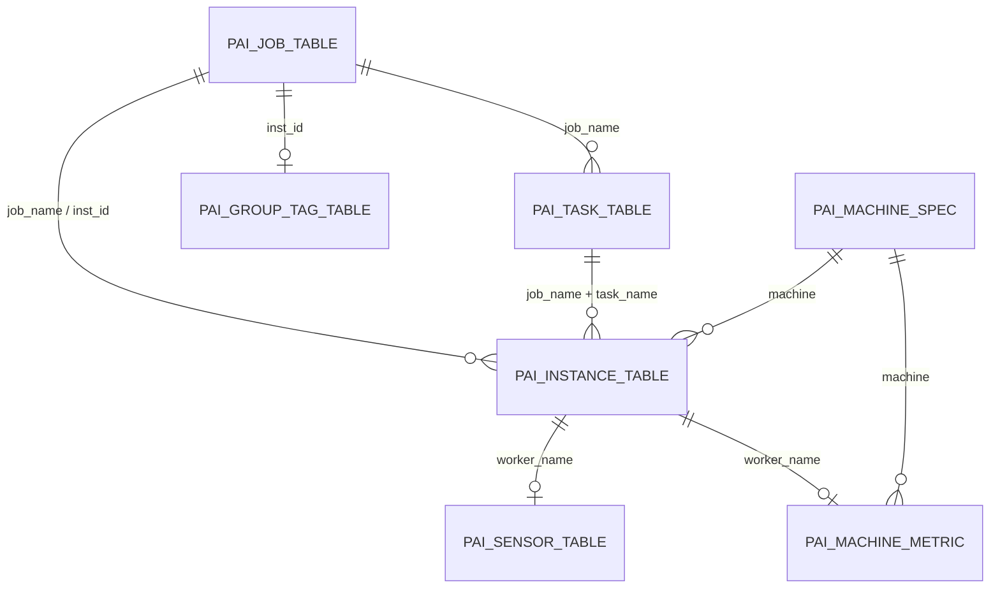

# 阶段 1：数据表关系与关联完整性

## 1. 官方关系模型

说明：图中 `||--o|` 只表示逻辑上最多一条观测记录；实际历史数据对 sensor 和 machine_metric 是部分覆盖，不能理解为全量 1:1。

## 2. 已验证的唯一键

| 表 | 候选键 | 非空唯一值 | 结论 |
|---|---|---:|---|
| job | job_name | 1,055,501 | 唯一主键 |
| job | inst_id | 1,055,501 | 与 job_name 1:1 |
| task | job_name + task_name | 1,261,050 | 唯一任务键 |
| instance | job_name + task_name + inst_name | 6,846,883 | 近似业务实例键；仍需处理空值语义 |
| instance | worker_name | 7,164,359 | 非空唯一，但 331,057 行为空 |
| sensor | worker_name | 3,033,232 | 与非空总行数一致 |
| sensor | worker_name + gpu_name | 3,033,232 | 与 worker_name 基数一致 |
| group_tag | inst_id | 1,055,032 | 唯一 |
| machine_spec | machine | 1,897 | 唯一 |
| machine_metric | worker_name + machine + start_time + end_time | 2,009,421 | 仅有 2 行键重复 |

哈希审计结论：七张表的完整行重复记录均为 0。

## 3. 关联覆盖率审计

审计方法：分块读取非空键，使用 Pandas 64 位哈希比较唯一键集合。哈希碰撞概率极低，但不进行密码学意义上的逐行连接。

| 左键 | 右键 | 左唯一键 | 右唯一键 | 完全匹配 | 左侧仅存在 | 右侧仅存在 | 左侧覆盖率 |
|---|---|---:|---:|---:|---:|---:|---:|
| job.job_name | task.job_name | 1,055,501 | 1,055,501 | 1,055,501 | 0 | 0 | 100.0000% |
| job.job_name | instance.job_name | 1,055,501 | 1,055,432 | 1,055,432 | 69 | 0 | 99.9935% |
| job.job_name | sensor.job_name | 1,055,501 | 1,054,352 | 837,529 | 217,972 | 1,149 | 79.3490% |
| job.inst_id | group.inst_id | 1,055,501 | 1,055,032 | 1,053,971 | 1,530 | 1,061 | 99.8550% |
| job.inst_id | instance.inst_id | 1,055,501 | 1,055,432 | 1,055,432 | 69 | 0 | 99.9935% |
| job.inst_id | sensor.inst_id | 1,055,501 | 1,054,352 | 837,529 | 217,972 | 1,149 | 79.3490% |
| task.job+task | instance.job+task | 1,261,050 | 1,260,920 | 1,260,920 | 130 | 0 | 99.9897% |
| task.job+task | sensor.job+task | 1,261,050 | 859,812 | 850,252 | 410,798 | 1,560 | 67.4241% |
| instance.worker_name | sensor.worker_name | 7,164,359 | 3,033,232 | 3,019,349 | 4,145,009 | 13,883 | 42.1440% |
| instance.worker_name | metric.worker_name | 7,164,359 | 2,009,421 | 2,009,421 | 5,154,937 | 0 | 28.0475% |
| instance.machine | sensor.machine | 1,897 | 1,743 | 1,731 | 166 | 6 | 91.2493% |
| instance.machine | metric.machine | 1,897 | 1,720 | 1,720 | 177 | 0 | 90.6695% |
| spec.machine | instance.machine | 1,897 | 1,897 | 1,897 | 0 | 0 | 100.0000% |
| spec.machine | metric.machine | 1,897 | 1,720 | 1,720 | 177 | 0 | 90.6695% |

原文完整结果：`reports/data_relationships.json`。

## 4. 对覆盖差异的解释

### 4.1 job → task

完全覆盖。每个历史作业至少有一个任务记录。

### 4.2 job/task → instance

- 69 个 job 没有 instance。
- 130 个 task 没有 instance，与 task 表 `inst_num` 缺失 130 行一致。
- instance 表中没有出现 job 表之外的 job_name。

这说明 instance 缺失集中在少量异常/未启动任务，不是大范围关联错误。

### 4.3 job → group_tag

- 1,530 个 job 的 inst_id 未出现在 group_tag。
- 1,061 个 group_tag 的 inst_id 未出现在 job。
- group_tag 行数比 job 少 469。

group_tag 是部分语义标注，不应作为所有 job 的强制外键。导入时应允许多对多覆盖差异，并在报告中标为“标签缺失/标签孤立”。

### 4.4 instance → sensor / machine_metric

这两个表只覆盖部分实例：

- sensor：约 42.14% 的 instance worker_name。
- machine_metric：约 28.05% 的 instance worker_name。

sensor 中尚有 13,883 个 worker_name 找不到对应 instance；sensor 的 job/inst_id 也有约 1,149–1,560 个孤立键。可能来源是数据采样、导出边界或异常记录，当前不能编造原因。

后续处理规则建议：

- 导入时保留孤立观测记录。
- 增加 `relation_status` 标记。
- 历史利用率分析必须显示覆盖率。
- 仿真引擎不得把孤立记录直接当作完整集群状态。

### 4.5 machine_spec → instance / machine_metric

- machine_spec 完整覆盖 instance 中 1,897 个非空 machine。
- machine_metric 只覆盖其中 1,720 台机器，约 90.67%。
- 6 个 sensor machine 找不到 instance 记录，需要作为异常保留。

## 5. 推荐逻辑外键

| 子表 | 父表 | 外键 | 处理方式 |
|---|---|---|---|
| historical_task | historical_job | job_name | 强制非空 |
| historical_instance | historical_job | job_name / inst_id | 强制，记录异常待查 |
| historical_instance | historical_task | job_name + task_name | 强制，130 条异常待查 |
| historical_sensor | historical_instance | worker_name | 可空，允许部分覆盖 |
| historical_machine_metric | historical_instance | worker_name | 可空，允许部分覆盖 |
| historical_instance | machine_spec | machine | 可空，状态相关 |
| historical_machine_metric | machine_spec | machine | 非空 |
| group_tag | historical_job | inst_id | 逻辑关联，不做强制删除 |

SQLite 外键在实际导入时可先不强制，以便保留孤立数据；导入完成后由质量报告列出违反记录。业务查询层再决定是否过滤。

## 6. 关系使用原则

1. “关联缺失”不等于“数据应删除”。
2. 状态为 Waiting/Ready 的实例没有机器分配，属于业务上合法的空值。
3. sensor 和 machine_metric 的覆盖率必须随分析结果一起展示。
4. 机器规格用于解释历史资源容量；仿真服务器配置另建配置表，不能直接修改机器规格。
5. 所有跨表聚合必须说明使用的是全量历史样本还是抽样样本。
