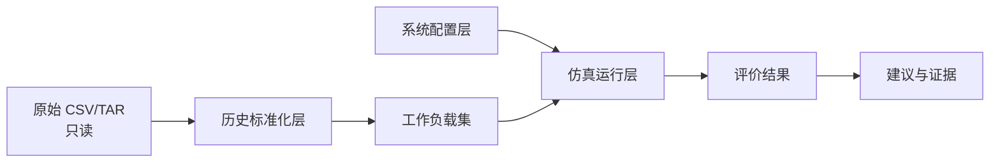
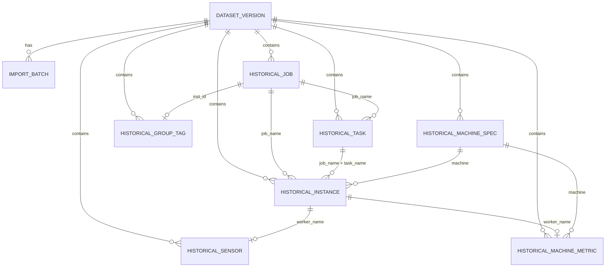
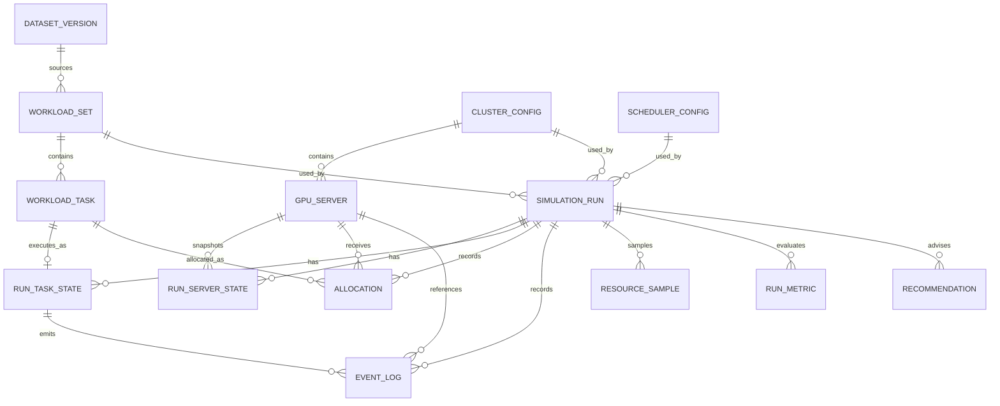

# 阶段 2：数据库设计

- 数据库：SQLite
- 访问技术：SQLAlchemy 2.x
- 设计原则：历史、配置、仿真分层；一次实验只引用冻结版本；已完成结果不可变
- 说明：本文是逻辑和物理表设计输入，不是最终建表 SQL

## 1. 数据分层与所有权

| 层 | 表 | 写入方 | 生命周期 |
|---|---|---|---|
| 历史元数据 | dataset_version、import_batch | 历史数据目录 | 一次导入永久保留 |
| 历史标准化 | historical_* | 历史数据目录 | 只读 |
| 配置 | cluster_config、gpu_server、scheduler_config | 集群/调度配置 | 版本化 |
| 工作负载 | workload_set、workload_task | 工作负载准备 | 引用后冻结 |
| 仿真 | simulation_run、run_server_state、run_task_state、allocation、event_log、resource_sample | 仿真引擎 | 实验内不可变 |
| 评价 | run_metric、comparison_result | 评价模块 | 公式版本化 |
| 建议 | recommendation | AI 建议模块 | 可记录接受状态 |

## 2. 历史数据 ER 图

实际覆盖率是部分的。图中的 0..1 表示逻辑最高基数，不表示所有实例都有观测数据。

## 3. 配置、工作负载与仿真 ER 图

## 4. 历史标准化表

### 4.1 `dataset_version`

| 字段 | 类型 | 约束 | 说明 |
|---|---|---|---|
| id | TEXT/UUID | PK | 数据集版本 ID |
| version_code | TEXT | UNIQUE, NOT NULL | 例如 `alibaba-gpu-2020-v1` |
| source_uri | TEXT | NOT NULL | 官方来源 |
| manifest_json | TEXT | NOT NULL | 文件大小、SHA、列映射、行数 |
| import_mode | TEXT | NOT NULL | FULL / SAMPLED |
| sampling_rule_json | TEXT | NULL | 抽样规则 |
| status | TEXT | NOT NULL | IMPORTING / READY / FAILED / ARCHIVED |
| activated_at | DATETIME | NULL | 可被实验引用的时间 |
| created_at | DATETIME | NOT NULL | 创建时间 |

索引：`(status, activated_at)`。

### 4.2 `import_batch`

| 字段 | 类型 | 约束 | 说明 |
|---|---|---|---|
| id | TEXT/UUID | PK | 批次 ID |
| dataset_version_id | TEXT | FK | 数据集版本 |
| table_name | TEXT | NOT NULL | 七表之一 |
| source_sha256 | TEXT | NOT NULL | 源文件哈希 |
| status | TEXT | NOT NULL | PENDING / RUNNING / SUCCESS / FAILED |
| rows_seen | INTEGER | NOT NULL DEFAULT 0 | 读取行数 |
| rows_inserted | INTEGER | NOT NULL DEFAULT 0 | 写入行数 |
| started_at | DATETIME | NULL | 开始时间 |
| finished_at | DATETIME | NULL | 结束时间 |
| error_summary | TEXT | NULL | 错误摘要 |

唯一约束：`(dataset_version_id, table_name, source_sha256)`。

### 4.3 历史表通用字段

每张历史表都带：

- `id`：内部主键。
- `dataset_version_id`：所属版本。
- `source_row_no`：CSV 行号。
- `created_at`。

原始字段保留原名或明确映射名。空值保持 NULL，不转换成空字符串。

### 4.4 `historical_job`

关键字段：

- `job_name`、`inst_id`、`user_name`、`raw_status`
- `business_status`
- `relative_start_second`、`relative_end_second`、`duration_second`
- `has_started`、`has_finished`、`is_successful`

唯一约束：`(dataset_version_id, job_name)`。
索引：`(dataset_version_id, raw_status, relative_start_second)`、`inst_id`。

### 4.5 `historical_task`

关键字段：

- `job_name`、`task_name`、`inst_num`、`raw_status`
- `relative_start_second`、`relative_end_second`、`duration_second`
- `plan_cpu_percent`、`plan_cpu_cores`
- `plan_mem_gb`
- `plan_gpu_percent`、`plan_gpu_equivalent`
- `gpu_type`

唯一约束：`(dataset_version_id, job_name, task_name)`。
索引：`(job_name, task_name)`、`(raw_status, relative_start_second)`。

### 4.6 `historical_instance`

关键字段：

- `job_name`、`task_name`、`inst_name`、`worker_name`、`inst_id`
- `raw_status`、`business_status`
- `relative_start_second`、`relative_end_second`、`duration_second`
- `machine`
- `is_assigned_to_machine`

不使用 `worker_name` 作为主键，因为存在 NULL 和少量重复。内部主键为 `id`，并建立来源行唯一约束 `(dataset_version_id, source_row_no)`。

索引：`worker_name`、`machine`、`(job_name, task_name)`、`inst_id`。

### 4.7 `historical_sensor`

- `worker_name`、`job_name`、`task_name`、`inst_id`、`machine`、`gpu_name`
- `cpu_usage_raw`
- `gpu_work_util_raw`
- `avg_mem_gb`、`max_mem_gb`
- `avg_gpu_mem_gb`、`max_gpu_mem_gb`
- `read_bytes_avg`、`write_bytes_avg`
- `read_count_avg`、`write_count_avg`

源行唯一约束：`(dataset_version_id, source_row_no)`。
索引：`worker_name`、`machine`。

### 4.8 `historical_group_tag`

- `inst_id`、`user_name`、`gpu_type_spec`、`group_name`、`workload`

唯一约束：`(dataset_version_id, inst_id)`。
索引：`group_name`、`workload`。

### 4.9 `historical_machine_spec`

- `machine`、`gpu_type`
- `cap_cpu_cores`、`cap_mem_gb`、`cap_gpu`
- `is_cpu_only`

唯一约束：`(dataset_version_id, machine)`。

### 4.10 `historical_machine_metric`

- `worker_name`、`machine`
- `relative_start_second`、`relative_end_second`
- `machine_cpu_iowait_pct`
- `machine_cpu_kernel_pct`
- `machine_cpu_usr_pct`
- `machine_gpu_raw`
- `machine_gpu_normalized`
- `machine_load_1`
- `machine_net_receive_bytes_avg`
- `machine_num_worker_avg`
- `machine_cpu_pct`

源行唯一约束：`(dataset_version_id, source_row_no)`。
索引：`worker_name`、`machine`。

## 5. 配置表

### 5.1 `cluster_config`

| 字段 | 类型 | 约束 | 说明 |
|---|---|---|---|
| id | TEXT/UUID | PK | 配置版本 ID |
| name | TEXT | NOT NULL | 集群名称 |
| version_no | INTEGER | NOT NULL | 版本号 |
| status | TEXT | NOT NULL | DRAFT / PUBLISHED / ARCHIVED |
| source_dataset_version_id | TEXT | NULL | 可选参考数据集 |
| config_hash | TEXT | NOT NULL | 冻结哈希 |
| created_at | DATETIME | NOT NULL | 创建时间 |
| published_at | DATETIME | NULL | 发布时间 |

唯一约束：`(name, version_no)`。

### 5.2 `gpu_server`

| 字段 | 类型 | 约束 | 说明 |
|---|---|---|---|
| id | TEXT/UUID | PK | 服务器 ID |
| cluster_config_id | TEXT | FK | 所属配置 |
| name | TEXT | NOT NULL | 服务器名称 |
| gpu_type | TEXT | NOT NULL | GPU 型号 |
| gpu_capacity | REAL | CHECK >= 0 | GPU 当量 |
| cpu_capacity | REAL | CHECK >= 0 | CPU 核数 |
| memory_capacity_gb | REAL | CHECK >= 0 | 内存 |
| status | TEXT | NOT NULL | ACTIVE / DRAINING / DISABLED |
| template_machine | TEXT | NULL | 历史机器模板引用 |
| created_at | DATETIME | NOT NULL | 创建时间 |

唯一约束：`(cluster_config_id, name)`。
约束：容量必须为正或服务器明确为禁用；GPU 型号不能为空。

### 5.3 `scheduler_config`

| 字段 | 类型 | 约束 | 说明 |
|---|---|---|---|
| id | TEXT/UUID | PK | 配置 ID |
| name | TEXT | NOT NULL | 配置名称 |
| preset | TEXT | NOT NULL | FIFO / SJF / PRIORITY / BEST_FIT / CUSTOM |
| order_rule | TEXT | NOT NULL | FIFO / SJF / PRIORITY |
| placement_rule | TEXT | NOT NULL | FIRST_FIT / BEST_FIT |
| weights_json | TEXT | NOT NULL | Best Fit 权重 |
| wait_sla_seconds | INTEGER | CHECK >= 0 | 超时判断阈值 |
| allow_skip_head | INTEGER | CHECK IN (0,1) | 是否允许遍历队列 |
| config_hash | TEXT | NOT NULL | 配置哈希 |

## 6. 工作负载表

### 6.1 `workload_set`

- `id`
- `name`
- `dataset_version_id`
- `filter_json`
- `sampling_mode`：ALL / STRATIFIED / CUSTOM
- `sampling_rule_json`
- `random_seed`
- `task_count`
- `input_hash`
- `status`：DRAFT / FROZEN / ARCHIVED
- `created_at`

### 6.2 `workload_task`

- `id`
- `workload_set_id`
- `name`
- `source_type`：HISTORICAL_REPLAY / USER_CREATED
- `source_ref_type`
- `source_ref_id`
- `submit_time`
- `priority`
- `estimated_duration`
- `gpu_required`
- `cpu_required`
- `memory_required_gb`
- `gpu_type_required`
- `deadline_time`
- `wait_sla_seconds`
- `is_schedulable`
- `quality_flags_json`

约束：

- `gpu_required`、`cpu_required`、`memory_required_gb`、`priority` 非负。
- 用户创建任务的 `estimated_duration > 0`；历史零时长记录默认排除，显式纳入时必须带 `ZERO_DURATION` 标记。
- 工作负载集 FROZEN 后禁止更新任务。

## 7. 仿真运行表

### 7.1 `simulation_run`

| 字段 | 类型 | 约束 | 说明 |
|---|---|---|---|
| id | TEXT/UUID | PK | 实验运行 ID |
| name | TEXT | NOT NULL | 实验名称 |
| workload_set_id | TEXT | FK, NOT NULL | 冻结工作负载 |
| cluster_config_id | TEXT | FK, NOT NULL | 冻结集群 |
| scheduler_config_id | TEXT | FK, NOT NULL | 调度配置 |
| random_seed | INTEGER | NOT NULL | 随机种子 |
| engine_version | TEXT | NOT NULL | 引擎版本 |
| input_hash | TEXT | NOT NULL | 输入组合哈希 |
| status | TEXT | NOT NULL | READY / RUNNING / PAUSED / COMPLETED / CANCELLED / FAILED |
| current_simulation_time | REAL | NOT NULL DEFAULT 0 | 当前仿真时间 |
| last_event_sequence | INTEGER | NOT NULL DEFAULT 0 | 最后事件序号 |
| started_at | DATETIME | NULL | 实际开始 |
| finished_at | DATETIME | NULL | 实际完成 |
| result_hash | TEXT | NULL | 最终结果哈希 |
| error_summary | TEXT | NULL | 失败原因 |

索引：`(status, started_at)`、`(input_hash, random_seed)`。

### 7.2 `run_server_state`

- `run_id`
- `server_id`
- `gpu_capacity`
- `cpu_capacity`
- `memory_capacity_gb`
- `gpu_allocated`
- `cpu_allocated`
- `memory_allocated_gb`
- `status`

主键：`(run_id, server_id)`。
约束：所有 allocated 不超过对应 capacity。

### 7.3 `run_task_state`

- `run_id`
- `workload_task_id`
- `status`
- `queue_enter_time`
- `scheduled_time`
- `start_time`
- `end_time`
- `assigned_server_id`
- `wait_duration`
- `turnaround_duration`
- `blocked_reason`
- `quality_flags_json`

主键：`(run_id, workload_task_id)`。

### 7.4 `allocation`

- `id`
- `run_id`
- `workload_task_id`
- `server_id`
- `decision_sequence`
- `decision_time`
- `gpu_allocated`
- `cpu_allocated`
- `memory_allocated_gb`
- `release_time`
- `decision_reason`
- `is_active`

索引：`(run_id, decision_sequence)`、`(run_id, server_id, is_active)`。

### 7.5 `event_log`

- `id`
- `run_id`
- `sequence_no`
- `event_time`
- `event_type`
- `task_id`
- `server_id`
- `payload_json`

唯一约束：`(run_id, sequence_no)`。
索引：`(run_id, event_time)`。

### 7.6 `resource_sample`

- `id`
- `run_id`
- `simulation_time`
- `server_id`
- `gpu_allocated`
- `cpu_allocated`
- `memory_allocated_gb`
- `gpu_utilization`
- `cpu_utilization`
- `memory_utilization`

索引：`(run_id, simulation_time)`、`(run_id, server_id, simulation_time)`。
采样应按仿真时间或状态变化降采样，不能无限写入每个前端 tick。

### 7.7 `snapshot`

- `id`
- `run_id`
- `simulation_time`
- `event_sequence`
- `state_json`
- `snapshot_type`：PAUSE / PERIODIC / FINAL

索引：`(run_id, event_sequence)`。

### 7.8 `run_metric`

- `id`
- `run_id`
- `metric_name`
- `dimension_type`
- `dimension_key`
- `metric_value`
- `formula_version`
- `sample_scope_json`

唯一约束：`(run_id, metric_name, dimension_type, dimension_key, formula_version)`。

### 7.9 `comparison_result`

- `id`
- `comparison_name`
- `run_ids_json`
- `compatibility_status`
- `incompatibility_reason`
- `result_json`
- `created_at`

### 7.10 `recommendation`

- `id`
- `run_id`
- `recommendation_type`
- `summary`
- `reasoning`
- `evidence_json`
- `rule_version`
- `accepted`
- `created_at`

## 8. 约束与索引原则

1. 每条资源写入都校验 `allocated + requested <= capacity`。
2. 所有事件序号在 `run_id` 内唯一。
3. 所有结果和指标必须绑定 `run_id`。
4. 配置、工作负载和数据集版本通过哈希校验冻结。
5. 历史查询必须带 `dataset_version_id` 或由激活版本隐式限定。
6. 大结果集必须分页或限制时间范围。
7. 索引依据真实查询，不创建无用途索引。
8. 对已发布/完成记录禁止原地更新，采用新版本或重算记录。

## 9. 迁移与初始化

首版使用 SQLAlchemy 元数据创建空数据库，并维护 `schema_version` 表。数据库结构变更采用编号迁移脚本；当变更复杂且无法通过简单脚本安全升级时，再引入 Alembic，避免首版增加不必要的工具成本。

数据初始化顺序：

1. 创建表与索引。
2. 导入并激活数据集版本。
3. 创建集群配置和调度配置。
4. 创建并冻结工作负载集。
5. 创建仿真运行。

## 10. 与阶段 1 建议的差异

阶段 1 提出历史标准化、配置、仿真三层结构，本阶段进一步确定：

- 以实例作为主要调度单元。
- 增加运行级服务器状态和任务状态表。
- 增加资源采样、快照、比较结果和建议表。
- 明确配置版本、工作负载集、实验运行和指标的哈希/版本绑定。
- 明确 SQLite 下不做复杂分区，而通过版本、抽样、索引和预聚合控制规模。
