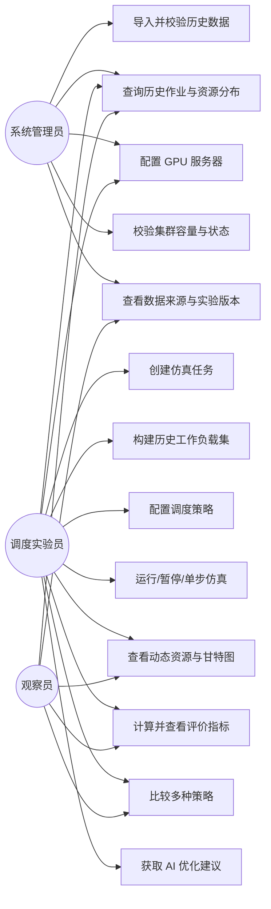
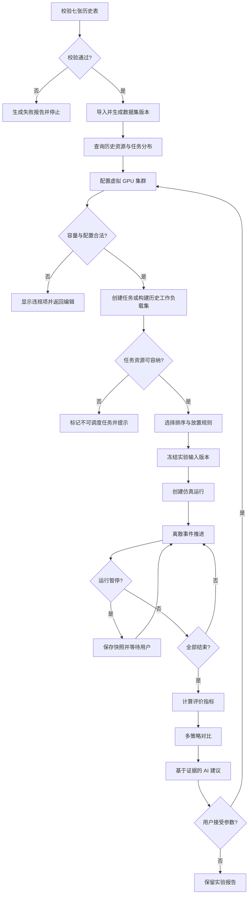

# 阶段 2：系统需求分析

- 阶段目标：明确 GPUFlow 的角色、业务能力、用例、核心流程、功能与非功能需求
- 依据：阶段 0/1 环境审计、真实数据字典、关联覆盖分析和项目原始需求
- 状态：分析完成，待阶段 2 评审

## 1. 系统目标与范围

GPUFlow 是一个单机部署、以真实历史数据为支撑的 GPU 集群资源管理与智能调度仿真系统。

系统必须形成可操作闭环：

```text
数据导入与审计
→ 历史数据分析
→ 虚拟 GPU 集群配置
→ 仿真任务/历史工作负载准备
→ 调度策略配置
→ 离散事件仿真
→ 动态过程展示
→ 指标评价
→ 多策略对比
→ 基于证据的优化建议
```

### 1.1 首版范围内

- 七张阿里 GPU Trace 表的分块导入、校验和查询。
- 历史任务、实例、机器规格和资源观测分析。
- 多服务器虚拟 GPU 集群配置。
- 用户创建任务与历史任务回放工作负载。
- FIFO、SJF、Priority、Best Fit 调度策略。
- 多资源约束与等待队列。
- 可暂停、继续、单步、重置的确定性离散事件仿真。
- 动态资源面板、排队列表和甘特图。
- 统一指标定义与策略对比。
- 基于真实指标和规则的 AI 辅助建议。

### 1.2 首版范围外

- 真实生产集群接入与控制。
- 真实 GPU 作业执行。
- 多节点分布式仿真集群。
- 用户注册、多租户和复杂权限管理。
- 在线训练大模型。
- 自动修改调度结果而不经用户确认。
- 伪造能耗、电价、碳排放等数据集中不存在的指标。

## 2. 利益相关者与角色

| 角色 | 主要目标 | 首版说明 |
|---|---|---|
| 系统管理员 | 导入数据、维护配置、检查数据质量 | 本地单用户兼有该角色 |
| 调度实验员 | 建任务、配集群、运行实验、比较策略 | 核心用户 |
| 观察员 | 查看仪表盘、实验过程和报告 | 只读能力，后续可扩展登录 |
| 课程评审者 | 验证系统真实运行、算法正确和可追溯 | 使用演示模式查看证据 |

首版采用单机本地操作员模式，不实现登录。角色作为能力边界和未来扩展点保留，防止把权限判断散落到页面中。

### 2.1 角色能力矩阵

| 能力 | 系统管理员 | 调度实验员 | 观察员 |
|---|:---:|:---:|:---:|
| 导入和审计数据 | 是 | 否 | 否 |
| 查看历史数据 | 是 | 是 | 是 |
| 配置服务器和集群 | 是 | 是 | 否 |
| 创建和修改任务 | 是 | 是 | 否 |
| 运行、暂停、重置仿真 | 是 | 是 | 否 |
| 查看动态仿真 | 是 | 是 | 是 |
| 比较策略 | 是 | 是 | 是 |
| 查看 AI 建议 | 是 | 是 | 是 |
| 接受 AI 建议参数 | 是 | 是 | 否 |
| 删除已完成实验 | 是 | 否 | 否 |

## 3. 业务能力与上下文

| 上下文 | 责任 | 拥有的数据 | 不负责 |
|---|---|---|---|
| 历史数据目录 | 导入、校验、查询和回放来源数据 | 数据集版本、历史表、导入批次 | 调度决策 |
| 集群配置 | 管理虚拟服务器和资源容量 | 服务器、集群配置版本 | 执行任务 |
| 工作任务准备 | 创建用户任务或构建历史工作负载集 | 工作负载集、仿真任务定义 | 分配资源 |
| 调度与仿真 | 排序、放置、状态推进和事件记录 | 调度决策、分配、事件、快照 | 评价口径解释 |
| 评价与建议 | 计算指标、比较实验、生成证据化建议 | 指标结果、比较结果、建议 | 修改调度结果 |

逻辑上下文与物理部署解耦。首版全部运行在一个模块化单体和一个 SQLite 数据库中。

## 4. 用例图



## 5. 用例目录

| 编号 | 用例 | 主要角色 | 优先级 | 核心结果 |
|---|---|---|---|---|
| UC-DATA-01 | 导入并校验历史数据 | 管理员 | P0 | 生成不可变数据集版本 |
| UC-DATA-02 | 查询历史作业与任务 | 全部 | P0 | 返回有来源标识的历史查询结果 |
| UC-DATA-03 | 分析资源需求与观测分布 | 全部 | P1 | 生成真实历史统计 |
| UC-CLUSTER-01 | 新增/编辑/删除虚拟服务器 | 管理员/实验员 | P0 | 更新集群配置版本 |
| UC-CLUSTER-02 | 校验集群容量 | 管理员/实验员 | P0 | 阻止超额配置或非法配置 |
| UC-TASK-01 | 创建/修改用户仿真任务 | 实验员 | P0 | 写入合法任务定义 |
| UC-TASK-02 | 构建历史工作负载集 | 实验员 | P0 | 生成可复现任务集合 |
| UC-SCHED-01 | 配置排序与放置规则 | 实验员 | P0 | 生成调度配置版本 |
| UC-SIM-01 | 启停、暂停、继续、单步、重置仿真 | 实验员 | P0 | 产生确定事件序列 |
| UC-SIM-02 | 查看动态仿真过程 | 全部 | P0 | 展示引擎真实状态 |
| UC-EVAL-01 | 计算调度指标 | 全部 | P0 | 生成有公式版本的指标 |
| UC-EVAL-02 | 对比多策略实验 | 全部 | P1 | 生成统一条件对比结果 |
| UC-AI-01 | 获取规则化调度建议 | 全部 | P1 | 返回带证据的候选项 |
| UC-SYS-01 | 查看数据与实验溯源 | 全部 | P0 | 展示来源、版本和参数 |

## 6. 核心用例说明

### 6.1 UC-DATA-01 导入并校验历史数据

前置条件：

- 七张 CSV 存在且路径可读。
- 数据库可写。

主流程：

1. 用户选择数据目录和导入模式。
2. 系统核对文件大小和官方 SHA-256。
3. 系统按固定字段映射分块读取。
4. 系统生成导入批次和数据集版本。
5. 系统写入历史标准化表并保留源行号。
6. 系统执行行数、键覆盖、缺失和状态完整性检查。
7. 系统生成导入报告，用户查看后激活数据集版本。

异常：

- 校验和不匹配：阻断激活，保留失败报告。
- 字段数量不匹配：阻断该表导入。
- 导入中断：批次标记失败，不产生可引用版本。
- 关系覆盖不足：允许完成导入，但必须在报告和界面警告。

验收：

- 七表行数与阶段 1 审计一致。
- 同一文件重复导入不会产生重复历史记录。
- 数据集版本不可被业务操作修改。

### 6.2 UC-CLUSTER-01 配置虚拟 GPU 服务器

前置条件：存在激活的数据集版本或允许独立创建集群配置。

主流程：

1. 用户新增服务器，填写名称、GPU 型号、GPU 数量、CPU 核数、内存容量。
2. 系统校验容量为正数、名称唯一、GPU 型号合法。
3. 用户可参考历史机器规格创建模板。
4. 系统保存服务器草稿。
5. 用户提交集群配置版本。
6. 系统校验服务器数量、资源总量和运行状态。
7. 新版本可供新实验选择；旧实验继续使用冻结版本。

验收：

- 已分配资源不得超过容量。
- 修改集群不会改变历史实验引用的版本。
- 删除被活动实验引用的服务器必须被拒绝或要求创建新版本。

### 6.3 UC-TASK-02 构建历史工作负载集

主流程：

1. 用户选择数据集版本。
2. 按状态、时间范围、GPU 类型、用户或资源范围筛选历史任务/实例。
3. 系统显示命中数量和覆盖率。
4. 用户选择全量或确定性分层抽样。
5. 系统把每条可调度实例映射为仿真任务。
6. 系统保存筛选条件、抽样规则、随机种子、任务数量和数据版本。
7. 系统检查任务资源是否至少能由一台虚拟服务器容纳。

规则：

- 缺失关键调度资源的历史记录不得被无提示补造。
- `plan_gpu` 与 `gpu_type` 同时缺失时标记 `GPU_DEMAND_UNKNOWN`，默认不进入 GPU 工作负载；如用户选择按 CPU-only 历史记录处理，必须记录该假设。
- `plan_cpu` 或 `plan_mem` 缺失时不得默认为 0，必须排除或由用户显式选择替代规则。
- 零时长历史记录默认排除；显式纳入时保留原值并标记 `ZERO_DURATION`。
- 资源单位从百分比转换为 GPU 当量和 CPU 核。
- 若历史 task 缺少 instance 明细，是否展开 `inst_num` 必须由用户明确选择。
- 工作负载集一经实验引用即冻结。

### 6.4 UC-SIM-01 运行调度仿真

前置条件：

- 已冻结工作负载集、集群配置和调度配置。
- 工作负载非空。

主流程：

1. 系统创建仿真运行并写入配置哈希和随机种子。
2. 引擎初始化服务器资源、等待队列、事件队列和仿真时间。
3. 引擎处理任务到达事件。
4. 引擎按排序规则选择候选任务。
5. 引擎按放置规则寻找满足 GPU、CPU、内存和 GPU 型号约束的服务器。
6. 满足条件时写入分配和启动事件；不满足时任务留在等待队列。
7. 引擎推进到下一个完成或到达事件。
8. 任务完成时释放资源、更新状态并记录事件。
9. 所有任务完成或到达不可调度终止条件后结束运行。
10. 系统计算指标并保存结果。

验收：

- 任何时刻已分配资源不超过服务器容量。
- 相同输入和种子得到相同事件序列。
- 等待任务不会在资源不足时被强制分配。
- 页面播放速度不改变业务结果。

### 6.5 UC-EVAL-02 对比多策略实验

前置条件：

- 至少两个实验使用相同数据集版本、工作负载集、集群配置和到达序列。
- 随机种子一致。

主流程：

1. 用户选择多个兼容实验。
2. 系统检查输入一致性。
3. 系统展示指标表、柱状图、利用率曲线和完成时间分布。
4. 系统注明不兼容实验及原因。
5. 系统生成结论摘要，结论必须引用实际指标。

禁止：

- 为让某策略胜出而修改任务集合。
- 用不同集群容量直接比较而不标注。
- 用历史监控值代替仿真利用率。

## 7. 业务流程



## 8. 功能需求

### 8.1 数据中心

- FR-DATA-01：支持带进度反馈的分块导入。
- FR-DATA-02：校验官方 SHA-256 并保存文件元数据。
- FR-DATA-03：展示每张表的行数、列数、缺失、重复和关联覆盖。
- FR-DATA-04：支持历史作业、任务、实例分页查询。
- FR-DATA-05：支持按状态、用户、GPU 类型和时间范围筛选。
- FR-DATA-06：所有图表标注真实历史数据来源和样本覆盖率。
- FR-DATA-07：保留源行号和导入批次，支持回溯。
- FR-DATA-08：禁止 UI 直接修改历史原始记录。

### 8.2 集群配置

- FR-CLST-01：支持服务器新增、编辑、停用和删除草稿。
- FR-CLST-02：每台服务器独立维护 GPU、CPU 和内存容量。
- FR-CLST-03：校验资源非负、名称唯一、至少有一种可调度资源。
- FR-CLST-04：支持按 GPU 型号建立服务器分组。
- FR-CLST-05：展示总容量、已分配、剩余和利用率。
- FR-CLST-06：支持集群配置版本化。
- FR-CLST-07：活动实验引用的配置不可原地修改。
- FR-CLST-08：阻止资源超额分配。

### 8.3 任务与工作负载

- FR-TASK-01：支持创建、编辑、取消用户仿真任务。
- FR-TASK-02：任务包含 GPU、CPU、内存、优先级、到达时间、预计时长和 GPU 型号要求。
- FR-TASK-03：支持从真实历史数据构建工作负载集。
- FR-TASK-04：支持固定随机种子的分层抽样。
- FR-TASK-05：记录任务来源为 HISTORICAL_REPLAY 或 USER_CREATED。
- FR-TASK-06：展示任务等待、运行、完成、失败和取消状态。
- FR-TASK-07：资源不可容纳的任务不能进入强制分配流程。
- FR-TASK-08：工作负载集被实验引用后不可原地修改。

### 8.4 调度

- FR-SCHED-01：实现 FIFO 排序。
- FR-SCHED-02：实现 SJF 排序，缺失预计时长时使用明确回退规则。
- FR-SCHED-03：实现 Priority 排序，并定义同优先级次序。
- FR-SCHED-04：实现 First Fit 放置。
- FR-SCHED-05：实现 Best Fit 放置，按多资源剩余比例计算匹配度。
- FR-SCHED-06：同时校验 GPU、CPU、内存和 GPU 型号。
- FR-SCHED-07：不满足条件的任务进入等待队列。
- FR-SCHED-08：保存每次调度决策及原因。

### 8.5 仿真

- FR-SIM-01：独立仿真引擎不得依赖 Streamlit 运行。
- FR-SIM-02：支持启动、暂停、继续、单步、重置和取消。
- FR-SIM-03：支持播放速度调节但不改变业务结果。
- FR-SIM-04：以事件驱动方式推进时间。
- FR-SIM-05：任务完成后自动释放资源。
- FR-SIM-06：记录事件类型、时间、任务、服务器和序号。
- FR-SIM-07：保存周期性状态快照和资源采样。
- FR-SIM-08：同一配置和种子可复现。
- FR-SIM-09：检测并报告不可调度任务。
- FR-SIM-10：提供最终实验结果哈希。

### 8.6 可视化

- FR-VIS-01：展示总 GPU、已分配、剩余和利用率。
- FR-VIS-02：展示每台服务器状态。
- FR-VIS-03：展示等待队列。
- FR-VIS-04：展示运行任务和完成进度。
- FR-VIS-05：展示动态甘特图。
- FR-VIS-06：展示 GPU、CPU、内存时间线。
- FR-VIS-07：图表数据必须直接来自仿真事件或快照。
- FR-VIS-08：支持仿真时间轴和单步回看。

### 8.7 评价与 AI

- FR-EVAL-01：实现统一指标公式。
- FR-EVAL-02：支持任务分布、利用率曲线和策略柱状图。
- FR-EVAL-03：支持实验兼容性检查。
- FR-AI-01：提供集群拥堵、资源碎片和策略推荐规则。
- FR-AI-02：建议必须引用指标、事件或配置。
- FR-AI-03：AI 建议只提供候选项，不直接改变运行。
- FR-AI-04：用户接受建议后生成新的配置草稿。

## 9. 非功能需求

| 类别 | 要求 |
|---|---|
| 真实性 | 历史、配置、仿真数据必须来源可区分、可追溯 |
| 可复现性 | 固定输入版本与种子得到相同事件序列、指标和结果哈希 |
| 性能 | 大数据分块导入；查询分页；抽样模式下页面主要操作目标 2 秒内响应 |
| 可扩展性 | 首版单机；仿真引擎与 UI 解耦，为后续独立工作进程保留接口 |
| 一致性 | 资源分配在服务器容量边界内，调度状态转换必须合法 |
| 可测试性 | 核心策略、状态机、指标和仿真引擎可脱离 UI 测试 |
| 可维护性 | 模块化单体；业务逻辑不得集中到 `app.py` |
| 可观测性 | 关键导入、决策和运行事件可查询；错误包含上下文 |
| 安全性 | 密钥只用环境变量；无密钥提交；输入做类型和范围校验 |
| 可用性 | 明确空状态、失败原因、数据来源和单位 |
| 可访问性 | 图表提供文本摘要和替代说明，颜色不是唯一状态编码 |
| 可移植性 | Windows 本地可运行；依赖由 `environment.yml` 固定范围 |
| 数据规模 | 支持全量审计和大表抽取；不得一次性加载 2 GB CSV |
| 结果边界 | 历史观测、仿真结果和 AI 建议不得混淆 |

## 10. 关键业务规则

1. 资源分配不能超过服务器容量。
2. Waiting/Ready 历史实例没有机器是合法状态。
3. 仿真任务必须整体放置在一台服务器；MVP 不拆分为跨服务器子任务。
4. GPU 型号不匹配时不得分配。
5. 任务排序和服务器放置是两个独立规则维度。
6. 仿真过程只由引擎事件推进，不由前端定时器决定。
7. 播放速度只影响展示节奏，不影响计算结果。
8. 已完成实验不可修改；调整参数必须创建新实验。
9. 历史数据中的空值必须有原因标记，不能无提示填充。
10. AI 建议不能绕过资源约束。

## 11. 验收标准

### 11.1 数据验收

- 七表官方校验和通过。
- 导入记录数、缺失和主键统计可复核。
- 历史查询结果包含数据集版本和来源。

### 11.2 资源验收

- 新增服务器后总容量即时正确。
- 非法容量被拒绝。
- 已分配加剩余等于容量。
- 配置版本切换不改变旧实验。

### 11.3 调度与仿真验收

- FIFO、SJF、Priority 排序有确定性测试。
- First Fit、Best Fit 放置有确定性测试。
- 多资源不足时任务进入等待。
- 任务完成后资源准确释放。
- 不存在超额分配。
- 相同输入重复运行结果一致。

### 11.4 系统验收

- Streamlit 页面正常运行。
- 页面状态与引擎快照一致。
- 数据库读写失败有明确错误。
- 大数据查询不会一次性加载全部 CSV。
- 所有图表可追溯到实验或数据集版本。

## 12. 需求追踪矩阵

| 用例 | 主要模块 | 关键测试 |
|---|---|---|
| UC-DATA-01 | 历史数据目录 | 校验和、分块导入、重复导入 |
| UC-DATA-02 | 历史数据目录、可视化 | 查询过滤、分页、来源标识 |
| UC-CLUSTER-01/02 | 集群配置 | 容量约束、版本冻结 |
| UC-TASK-01/02 | 工作负载准备 | 任务合法性、历史映射、抽样复现 |
| UC-SCHED-01 | 调度 | 排序/放置独立性、多资源约束 |
| UC-SIM-01/02 | 仿真、可视化 | 状态机、事件顺序、资源释放、快照一致 |
| UC-EVAL-01/02 | 评价 | 公式样例、兼容性、策略对比 |
| UC-AI-01 | 建议 | 证据引用、只读边界 |
| UC-SYS-01 | 全局只读查询 |  provenance 完整性 |

## 13. 风险与待确认事项

| 风险/问题 | 当前建议 |
|---|---|
| 全量历史数据导入影响页面性能 | 原型默认确定性分层抽样，最终支持全量 |
| 历史任务与实例资源单位转换复杂 | 以实例为调度单元，优先使用实例明细 |
| `inst_num` 缺失或实例不存在 | 不自动补造；在用户确认后展开或排除 |
| GPU 型号是否严格匹配 | 首版严格匹配，后续增加兼容矩阵 |
| 任务是否可跨服务器拆分 | 首版整体放置，不拆分 |
| 超时口径 | 使用可配置等待 SLA；有显式截止时间时优先使用截止时间 |
| 公平性维度 | 首版按用户，后续支持 group/workload |
| 登录与权限 | 首版本地单操作员，保留角色能力边界 |
