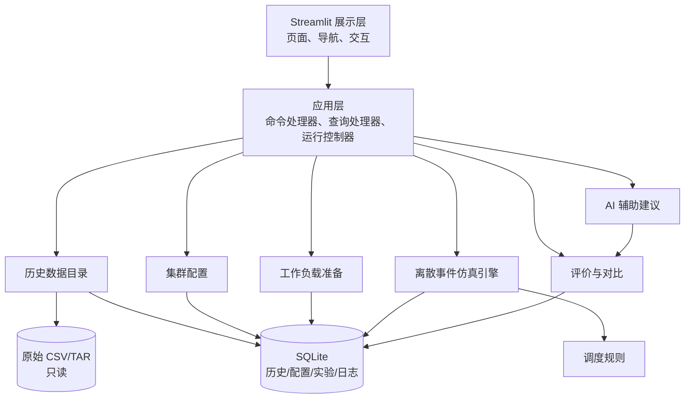
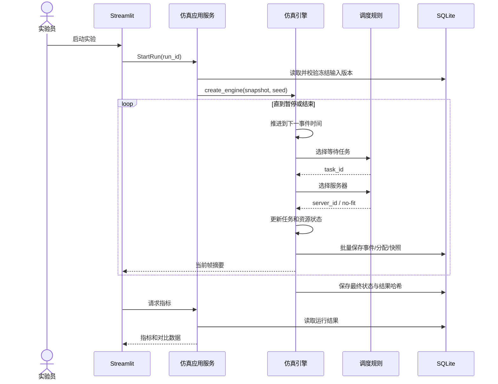
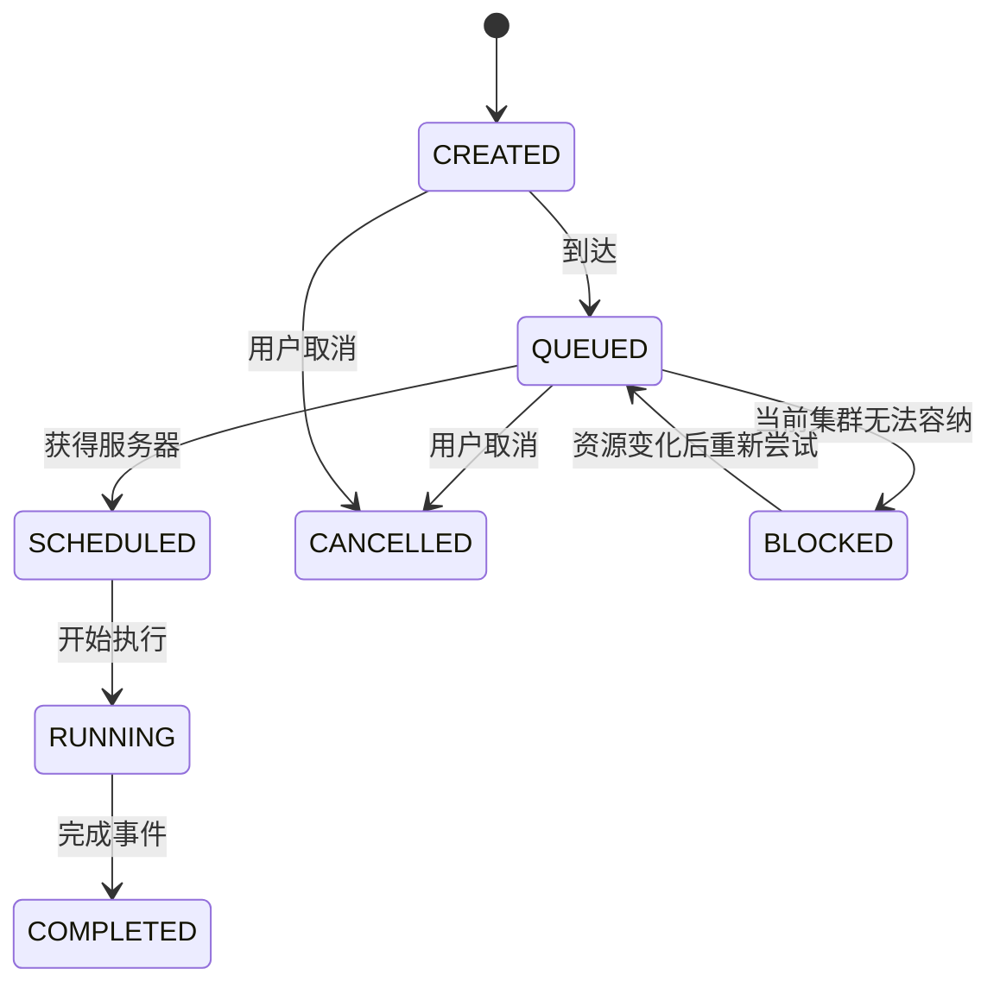
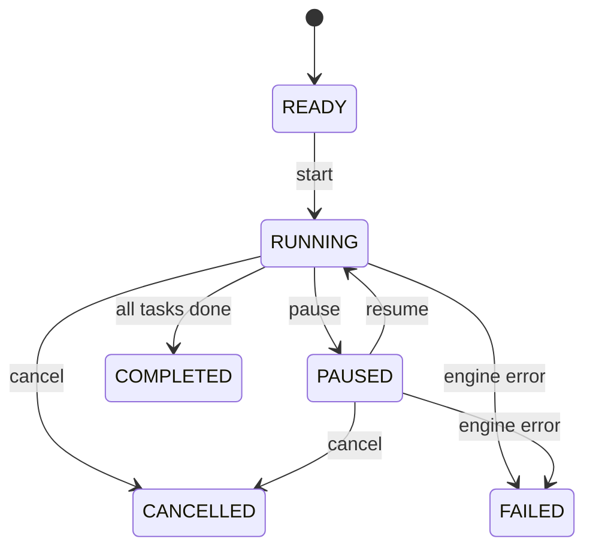

# 阶段 2：系统设计

- 设计目标：在单机、可维护、可测试、可复现的约束下实现完整业务闭环
- 架构结论：模块化单体 + 分层的数据存储 + 独立的离散事件仿真核心
- 相关决策：`docs/adr/0001-modular-monolith.md`、`docs/adr/0002-separate-data-provenance.md`、`docs/adr/0003-deterministic-discrete-event-engine.md`

## 0. 关键备选方案比较

### 0.1 架构拓扑

| 方案 | 优点 | 缺点 | 结论 |
|---|---|---|---|
| 纯分层单体 | 上手快、文件少 | 业务容易集中到服务层和 `app.py`，边界不稳定 | 不采用 |
| 模块化单体 | 单机部署简单，模块接口明确，可直接测试仿真核心 | 需要主动维护模块依赖规则 | 推荐 |
| 微服务 | 独立发布和扩容 | 网络、事务、部署和观测成本远超当前需求 | 不采用 |

### 0.2 仿真引擎位置

| 方案 | 优点 | 缺点 | 结论 |
|---|---|---|---|
| Streamlit 页面直接推进状态 | 实现快 | 页面重跑会破坏状态，算法无法独立测试 | 禁止 |
| 独立进程内引擎 | 可测试、可复用、与 UI 解耦 | 需要定义快照和序列化契约 | 推荐 |
| 外部仿真服务 | 可独立扩容 | 当前没有扩容需求，增加部署复杂度 | 后续按条件评估 |

### 0.3 数据存储

| 方案 | 优点 | 缺点 | 结论 |
|---|---|---|---|
| 直接查询 CSV | 无需导入 | 大文件反复扫描，关联和事务困难 | 不采用 |
| SQLite 标准化 | 单机、事务清晰、便于课程部署 | 大表并发和复杂分析能力有限 | 推荐首版 |
| PostgreSQL/DuckDB | 查询能力强 | 增加安装和运维成本 | 仅在全量数据成为验证瓶颈后评估 |

### 0.4 调度策略组合方式

| 方案 | 优点 | 缺点 | 结论 |
|---|---|---|---|
| 把 FIFO、SJF、Priority、Best Fit 都叫“算法”混在一起 | 界面简单 | 无法解释是排序还是放置导致差异 | 不采用 |
| 排序规则与放置规则分开 | 可解释、可组合、易测试 | 界面需要展示两个维度 | 推荐 |
| 任意组合全部开放 | 灵活 | 首版实验数量多、对比口径复杂 | 后续开放自定义组合 |
## 1. 设计原则

1. 业务规则不能写在 Streamlit 页面中。
2. 仿真引擎必须独立于 UI，可在命令行和测试中运行。
3. 历史观测、系统配置、仿真输出严格分离。
4. 每个状态转换只有一个逻辑所有者。
5. 模块之间通过窄接口和只读查询契约交互。
6. 排序规则与放置规则分开实现。
7. 仿真输入冻结、结果可复现、决策可追溯。
8. 先保证正确性，再实现播放动画和视觉优化。
9. 数据结构按业务用途设计，不做通用 Repository 或无意义抽象。
10. 不为当前单机场景引入微服务、消息队列或事件溯源基础设施。

## 2. 总体架构



### 2.1 物理部署

- 一个 Streamlit 进程。
- 一个 Python 领域核心包。
- 一个 SQLite 数据库文件。
- 原始数据目录只读。
- 仿真引擎在进程内运行；长实验通过后台线程或独立进程执行的能力作为后续扩展点。

### 2.2 为什么不是微服务

当前没有独立扩容、独立发布或多团队所有权需求。微服务会增加网络调用、分布式事务、部署、监控和测试成本。模块化单体可以先获得清晰边界，同时保留抽取仿真工作进程的可能。

## 3. 模块边界与所有权

| 模块 | 主要职责 | 拥有写入的表 | 可读取 |
|---|---|---|---|
| 历史数据目录 | 导入、校验、历史查询、工作负载候选查询 | `dataset_version`、`import_batch`、历史表 | 原始文件 |
| 集群配置 | 服务器和集群版本管理 | `gpu_server`、`cluster_config` | 实验引用状态 |
| 工作负载准备 | 用户任务、历史任务映射、抽样 | `workload_set`、`workload_task` | 历史查询契约 |
| 调度规则 | 排序、放置、资源约束 | 不直接写业务表 | 调度快照值对象 |
| 仿真引擎 | 时间推进、状态机、事件、分配、快照 | `simulation_run`、`allocation`、`event_log`、`snapshot`、`resource_sample` | 冻结输入 |
| 评价与对比 | 指标、分布、兼容性比较 | `run_metric`、`comparison_result` | 仿真结果 |
| AI 建议 | 规则分析、推荐和证据引用 | `recommendation` | 指标、事件和配置 |
| 展示层 | 页面、交互、图表 | 不直接写业务表 | 应用查询契约 |

## 4. 代码组织

推荐按“模块 + 用例切片”组织，而不是按 controller/service/repository 横向堆叠：

```text
app/
  main.py                     Streamlit 入口与页面注册
  pages/                      页面组合与展示组件
  components/                 图表、表格、状态卡
  view_models/                页面专用只读结构

src/gpu_sim/
  core/
    resources.py              ResourceVector、GPU 当量
    time.py                   SimulationTime
    errors.py                 业务错误
    ids.py                    ID 类型
  data_catalog/
    import_dataset/           一个完整用例切片
    query_history/
    analyze_quality/
  cluster_config/
    manage_server/
    publish_cluster/
    query_cluster/
  workload/
    create_task/
    build_historical_workload/
    query_workload/
  scheduling/
    order_tasks/
    place_task/
    policies/
  simulation/
    engine.py                 纯仿真核心
    run_control/              创建、启动、暂停、单步、取消
    query_timeline/
  evaluation/
    calculate_metrics/
    compare_runs/
  ai_advisor/
    recommend_strategy/
    explain_bottleneck/
  persistence/
    database.py
    migrations/
    queries/                   按用例提供查询，不做泛型仓储
```

### 4.1 垂直切片规则

每个用例切片拥有：

- 请求契约。
- 返回契约或错误契约。
- 处理器。
- 该用例需要的查询/持久化。
- 用例级测试。

共享领域行为只在同一生命周期内共享。例如任务状态机可被“调度”和“取消任务”共享，但不能把历史 Job 实体直接暴露给仿真模块。

### 4.2 模块依赖规则

- `app` 只能调用模块的应用接口，不导入模块内部持久化实现。
- `simulation` 可以依赖 `scheduling` 的纯规则接口和冻结输入值对象。
- `evaluation` 只读仿真运行结果，不调用调度决策改变状态。
- `ai_advisor` 只读评价结果和事件，不写仿真表。
- 模块之间禁止跨表写入。
- 依赖方向通过架构测试验证。

## 5. 关键领域模型

### 5.1 资源向量

```text
ResourceVector(
    gpu_equivalent: float,
    cpu_cores: float,
    memory_gb: float,
    gpu_type: str | None
)
```

不变量：

- 数值不能为负。
- GPU 型号只在需求侧可选；服务器侧必须有确定型号。
- 历史百分比在导入边界转换为当量，内部不再使用百分比。
- `plan_gpu` 和 `gpu_type` 同时缺失时标记 `GPU_DEMAND_UNKNOWN`，默认排除；按 CPU-only 处理必须由用户显式选择并记录。
- 缺失 `plan_cpu` 或 `plan_mem` 不填充为 0；默认排除或使用用户确认的替代规则。

### 5.2 虚拟服务器

```text
GPUServer(
    server_id,
    name,
    gpu_type,
    capacity: ResourceVector,
    allocated: ResourceVector,
    status
)
```

不变量：

- `allocated <= capacity` 按每一种资源分别成立。
- 型号不符时 GPU 不可分配。
- 停用服务器没有新分配，但已有任务可完成并释放资源。

### 5.3 可调度任务

```text
SchedulableTask(
    task_id,
    workload_set_id,
    source_type,
    source_reference,
    submit_time,
    priority,
    estimated_duration,
    demand: ResourceVector,
    deadline | wait_sla
)
```

首版一个可调度任务整体放置在一台服务器，不跨服务器拆分。

### 5.4 仿真运行

`SimulationRun` 聚合根维护：

- 冻结的输入版本 ID。
- 运行状态。
- 仿真当前时间。
- 随机种子和确定性序列。
- 事件序号。
- 结果哈希。

任务状态和资源分配数量较大，不全部塞进运行聚合。引擎在内存中维护状态，通过事件和快照持久化。

## 6. 核心用例的运行时顺序



## 7. 调度算法设计

### 7.1 调度策略预设

| 预设 | 排序规则 | 放置规则 |
|---|---|---|
| FIFO | 到达时间升序，再按任务序号 | First Fit |
| SJF | 预计运行时长升序，再按到达时间 | First Fit |
| Priority | 优先级降序，再按到达时间 | First Fit |
| Best Fit | 到达时间升序，再按任务序号 | Best Fit |

Best Fit 作为同一个基线排序下的放置规则，避免同时改变排序与放置导致无法解释实验结果。后续允许自定义矩阵，例如 `FIFO + Best Fit`。

### 7.2 排序规则

FIFO：

```text
sort by (submit_time, sequence_no)
```

SJF：

```text
sort by (estimated_duration, submit_time, sequence_no)
```

Priority：

```text
sort by (-priority, submit_time, sequence_no)
```

确定性要求：

- 所有比较器必须有最终 tie-breaker。
- 不能依赖 Python 字典或数据库无序结果。
- 同一时刻事件按 `sequence_no` 稳定排序。

### 7.3 放置规则

候选服务器必须同时满足：

1. 状态为可调度。
2. GPU 型号兼容。
3. `remaining_gpu >= task.gpu`。
4. `remaining_cpu >= task.cpu`。
5. `remaining_memory >= task.memory`。

First Fit：

- 按稳定的服务器排序键依次选择第一个满足条件的服务器。

Best Fit：

```text
remaining_ratio_r = (capacity_r - allocated_r - demand_r) / capacity_r
fit_score = w_gpu * remaining_ratio_gpu
          + w_cpu * remaining_ratio_cpu
          + w_mem * remaining_ratio_memory
```

选择 `fit_score` 最小的服务器；默认权重相等。平局按服务器稳定 ID 选择。

Best Fit 只改变资源放置，不改变任务排序。

### 7.4 调度循环

```text
while not finished:
    next_event = event_queue.peek()
    current_time = next_event.time
    process all arrivals at current_time
    release all completions at current_time

    while True:
        ordered_tasks = order(waiting_queue)
        selected = first task that can be placed
        if selected is None:
            break
        server = place(selected, servers)
        if server is None:
            break

        allocate(selected, server)
        schedule completion event
        record decision

    if no task can make progress:
        mark blocked tasks as unschedulable-waiting
        break or advance to next event
```

是否允许“跳过队列头部任务”需要明确。首版建议：

- FIFO：严格队头，队头无法放置时停止本轮调度。
- SJF / Priority：可遍历排序队列，选择第一个能放置的任务；但其等待和公平性必须在文档中说明。
- 可选择开启 backfill 作为后续功能，首版不实现。

## 8. 状态机

### 8.1 仿真任务状态



### 8.2 仿真运行状态



禁止转换：

- COMPLETED → RUNNING
- CANCELLED → RUNNING
- 用户直接修改 RUNNING 实验的冻结输入

## 9. 持久化与事务边界

### 9.1 导入

- 每批 20 万行左右写入一个短事务。
- 整张表导入状态由 `import_batch` 记录。
- 全部表成功后才激活数据集版本。
- 失败批次保留错误摘要，不产生可引用版本。

### 9.2 配置

- 新增/编辑服务器使用短事务。
- 发布集群配置时冻结所有服务器快照。
- 已有运行引用的配置版本不可变。

### 9.3 仿真

- 不在整个运行期间持有数据库长事务。
- 引擎按事件批次写入事件、分配和资源采样。
- 暂停时强制保存快照。
- 完成时在短事务中写入最终状态、指标和结果哈希。
- 崩溃恢复从最近快照加后续事件重建；首版可先只保证暂停快照恢复。

### 9.4 结果不可变

已完成的仿真运行和指标不得更新。重算只能生成带公式版本的新指标记录。

## 10. 评价与 AI

评价模块只读取仿真输出，按 `docs/stage2_metrics_definitions.md` 计算指标。

AI 建议模块首版采用规则：

- 等待队列持续增长 → 建议增加同型号 GPU 或调整策略。
- GPU 碎片多但 CPU/内存充足 → 建议检查 Best Fit 或服务器分组。
- 某型号 GPU 长期不足 → 建议调整服务器型号比例。
- 高优先级任务被长时间等待 → 建议 Priority 或预留容量。
- 高利用率伴随高等待 → 区分“忙”与“拥堵”。

每条建议包含：

- 结论摘要。
- 规则版本。
- 引用指标。
- 引用事件或实验 ID。
- 可执行的配置草稿建议。
- 是否由用户接受。

## 11. 展示层设计

目标页面：

1. 系统总览。
2. 数据中心。
3. GPU 资源管理。
4. 任务管理。
5. 调度控制台。
6. 动态仿真。
7. 策略对比。
8. AI 决策。
9. 设置与溯源。

展示层规则：

- 所有数字标出单位和数据来源。
- 历史观测与仿真利用率使用不同标签和颜色语义。
- 图表通过 Plotly 渲染，数据由查询处理器提供。
- 页面不自行计算调度结果。
- 播放速度只控制帧展示。
- 大数据表分页加载。
- 空状态必须说明缺少什么数据。

## 12. 测试设计

### 12.1 单元测试

- ResourceVector 运算和边界。
- 服务器容量约束。
- FIFO、SJF、Priority 排序和 tie-breaker。
- First Fit、Best Fit 放置。
- 任务和运行状态机。
- 指标公式样例。

### 12.2 集成测试

- 分块导入小样本 CSV。
- 配置版本冻结。
- 调度决策写入和读取。
- 暂停后恢复的一致性。
- 指标查询和实验对比。

### 12.3 端到端测试

- 导入 → 配置 → 工作负载 → 仿真 → 图表 → 对比。
- 非法配置和资源不足路径。
- 相同配置重复运行的一致性。

## 13. 设计风险

| 风险 | 缓解 |
|---|---|
| Streamlit 重跑导致状态丢失 | 运行状态存于引擎/会话控制器，不依赖页面局部变量 |
| 全量数据查询过慢 | 索引、分页、预聚合和历史抽样 |
| 调度策略定义含混 | 排序和放置分离，预设固定并文档化 |
| 仿真与 UI 不同步 | 页面只读引擎快照和版本化事件 |
| 指标不可复现 | 指标公式版本化，绑定 run_id 和输入哈希 |
| 历史数据缺失导致偏差 | 保留样本，增加来源和质量标记 |
| SQLite 写放大 | 批量事务、事件批量写入、降采样资源采样 |
| AI 无依据 | 强制 evidence 字段和规则版本 |

## 14. 阶段 2 设计验收

- [x] 角色和能力边界明确
- [x] 用例图和业务流程图完成
- [x] 模块化单体架构确定
- [x] 上下文和数据所有权明确
- [x] 代码组织与垂直切片规则明确
- [x] 调度排序/放置规则分离
- [x] 仿真状态机和运行时顺序明确
- [x] 事务和持久化边界明确
- [x] 评价与 AI 边界明确
- [x] 页面结构和测试策略明确
- [ ] 数据库 ER 图与表设计（下一文档）
- [ ] 模块接口契约（下一文档）
