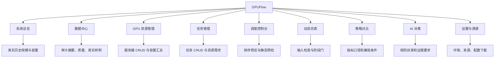
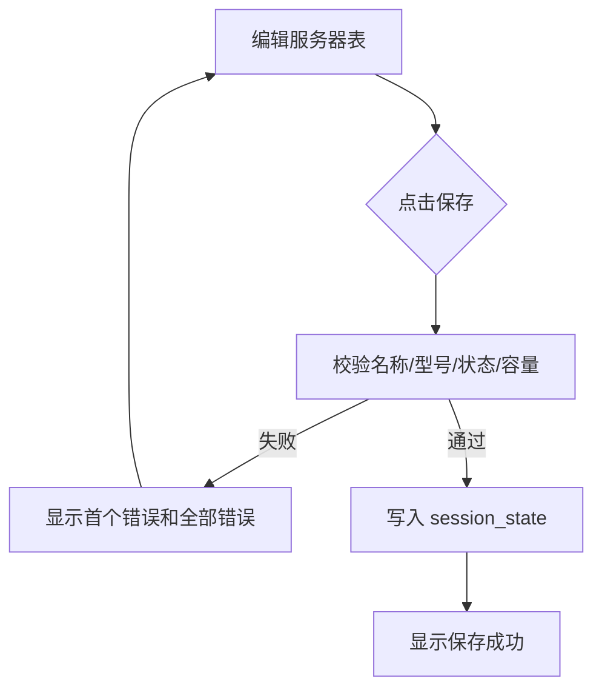
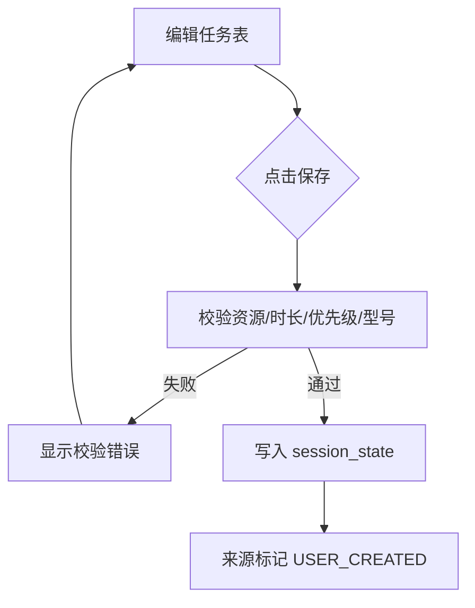
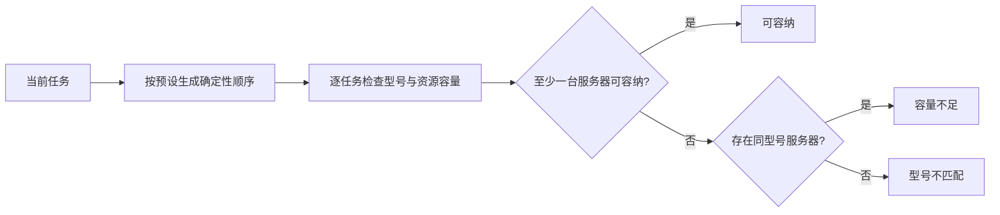

# 阶段 3：可操作 Web 原型设计

- 原型版本：GPUFlow Prototype v0.1
- 入口：`streamlit_app.py`
- 主题：深色科技风管理后台
- 数据边界：真实历史数据只读；服务器和任务使用系统配置数据；未生成仿真结果

## 1. 设计目标

阶段 3 的目标不是伪造一个“已经能仿真”的页面，而是先验证：

1. 九页面信息架构是否清晰。
2. 真实历史数据能否被正确展示和标注来源。
3. 用户能否配置服务器、任务和调度策略。
4. 调度排序和静态容量预检是否有可操作界面。
5. 阶段 4 仿真引擎需要的输入和状态边界是否明确。
6. 深色科技风是否适合课程展示，同时保持数据可读性。

## 2. 信息架构



侧边栏导航按业务阶段分为：

- 总览
- 资源配置
- 调度实验
- 智能决策
- 系统

## 3. 视觉规范

### 3.1 主题

锁定深色主题，避免演示时误切到亮色造成图表和状态卡对比不足。

| Token | 值 | 用途 |
|---|---|---|
| 页面背景 | `#07111F` | 深海军蓝背景 |
| 面板背景 | `#0E1B2D` | 卡片、表格、侧栏面板 |
| 主强调色 | `#22D3EE` | 按钮、关键链接、选中态 |
| 辅助蓝 | `#60A5FA` | 次强调和数据系列 |
| 主文字 | `#E6F1FF` | 高对比正文 |
| 边框 | `#1E3A55` | 清晰但不过度发光的边界 |
| 成功 | `#34D399` | 校验通过 |
| 警告 | `#FBBF24` | 仍需处理的风险 |
| 错误 | `#F87171` | 阻断性错误 |
| 阶段待办 | gray/orange badge | 未实现能力 |

设计约束：

- 不使用大面积渐变和发光。
- 不使用装饰性动画。
- 图表由 Streamlit 主题控制，避免一图一套颜色。
- 页面标题使用句首大写或中文自然命名，不用全大写标题。
- 图标统一使用 Material Symbols，不用 emoji 作为导航图标。

### 3.2 页面骨架

```text
┌─────────────────────────────────────────────────────────────┐
│ 侧边栏品牌 / 阶段状态                                       │
│ 总览 | 数据中心 | 资源 | 任务 | ...                         │
├─────────────────────────────────────────────────────────────┤
│ 页面标题                                                     │
│ 页面说明                                                     │
│ 数据来源 Badge                                               │
│                                                             │
│ [KPI 卡] [KPI 卡] [KPI 卡] [KPI 卡]                         │
│                                                             │
│ [主操作区或并列表格/图表]                                    │
│                                                             │
│ [说明、质量警告、下一步边界]                                 │
└─────────────────────────────────────────────────────────────┘
```

## 4. 页面设计

### 4.1 系统总览

目的：一屏回答“数据有多大、GPU 有多少、系统做到哪一步”。

组件：

- 真实历史记录数
- 历史 GPU 容量
- 历史作业数
- 机器规格数
- 按 GPU 型号统计的容量柱状图
- 历史作业状态分布
- 四级核心能力进度卡

真实数据来源：

- `reports/data_audit.json`
- `data/pai_machine_spec/pai_machine_spec.csv`

### 4.2 数据中心

三个页签：

1. 数据概况：七表规模、缺失、重复、校验状态。
2. 质量检查：状态性缺失、观测覆盖、GPU 指标口径、时间语义和标签覆盖。
3. 真实样例：按行数上限读取官方 CSV 前若干行，支持状态过滤。

明确说明：

- 预览不是全量分页查询。
- 时间字段为脱敏相对秒数。
- 缺失不代表可以删除。

### 4.3 GPU 资源管理

交互：

- `st.data_editor` 支持新增、编辑和删除服务器行。
- GPU 型号、状态使用选择列。
- 保存前执行名称唯一、容量非负、容量有限、GPU 容量大于 0 等校验。
- 保存写入当前 Streamlit 会话。
- 恢复示范配置会重置整个原型会话并切换编辑器版本。

展示：

- 服务器数、活动服务器、GPU/CPU/内存总容量。
- 按 GPU 型号的配置容量图。

### 4.4 任务管理

交互：

- 可动态增删任务。
- 编辑资源需求、优先级、预计时长、GPU 型号要求和到达时间。
- 保存前校验名称、资源、优先级、时长和任务来源。
- 来源固定为 `USER_CREATED`，避免把原型任务冒充历史回放任务。

展示：

- 任务数、总 GPU/CPU 需求、平均优先级。
- 按 GPU 型号汇总的任务需求图。

### 4.5 调度控制台

交互：

- 选择 FIFO、SJF、Priority、Best Fit 预设。
- 查看预设的排序规则和放置规则。
- 配置等待 SLA、随机种子和是否允许跳过队头。
- 保存调度配置到当前会话。
- 查看确定性任务排序预览。
- 查看每个任务的静态容量预检结果。

边界：

- 预检只检查单任务能否被单台服务器容纳。
- 不模拟并发占用、完成事件或资源释放。

### 4.6 动态仿真

展示：

- 任务数、活动服务器、调度预设和随机种子。
- 运行前检查清单。
- 当前任务静态可容纳性。
- 阶段 4 引擎状态。

交互：

- “重新检查输入”会重新计算检查结果并显示 toast。
- “开始仿真（阶段 4 启用）”明确禁用，不用假动画代替引擎。

### 4.7 策略对比

展示：

- 九项指标的定义和单位。
- 实验兼容性门槛。
- 四种策略预设的排序/放置规则。

状态：

- 尚无已完成仿真，因此不显示比较柱状图或胜负结论。
- 阶段 5 接入真实运行后显示指标表、利用率曲线和完成时间分布。

### 4.8 AI 决策

展示：

- 五类规则：拥堵、碎片、容量错配、优先级饥饿、策略推荐。
- 每条建议必须引用的运行、指标、事件和配置证据。
- 当前配置摘要。

边界：

- 不生成没有仿真数据支撑的自然语言结论。
- 阶段 6 先实现规则引擎，再决定是否接大模型。

### 4.9 设置与溯源

展示：

- Python 和依赖版本。
- 真实历史、系统配置、仿真和 AI 数据来源状态。
- 当前会话配置下载按钮。
- 重置原型配置按钮。

## 5. 核心交互状态

### 5.1 服务器配置保存



### 5.2 任务配置保存



### 5.3 调度预检



## 6. 数据真实性设计

页面统一显示数据来源 Badge：

- 蓝色：真实历史数据
- 紫色：系统配置数据
- 橙色：仿真生成数据
- 灰色：阶段原型

首版没有任何仿真结果，因此所有可能被误解为仿真结论的页面都显示阶段门和空状态，不绘制编造的趋势线、甘特图或利用率。

## 7. 可访问性与可读性

- 图表全部提供 `alt` 文本。
- 状态不只依赖颜色，配合文字 Badge。
- 所有数据列标注单位。
- 错误提示同时给出原因和修正方向。
- 深色主题使用高对比文字和边框。
- 表格和 KPI 卡在宽屏管理后台布局中展示。
- 导航和操作按钮使用 Material Symbols。

## 8. 代码组织

```text
streamlit_app.py              导航入口、全局会话初始化
.streamlit/config.toml        深色主题
assets/logo.svg               品牌标识
app_pages/*.py                九个页面
src/gpu_sim/prototype/logic.py      纯业务原型规则
src/gpu_sim/prototype/state.py      会话状态和编辑保存
src/gpu_sim/prototype/data_access.py 真实数据只读访问
src/gpu_sim/prototype/ui.py         共享展示组件
tests/test_prototype_logic.py       核心规则测试
tests/test_streamlit_pages.py       九页渲染测试
```

页面不直接读取原始 CSV 或维护业务规则；真实数据访问集中在 `data_access.py`，编辑校验和容量预检集中在 `logic.py`。

## 9. 运行方式

```powershell
conda activate gpu_analysis
streamlit run streamlit_app.py
```

验证入口：

- 默认地址：`http://localhost:8501`
- 测试时可用 `--server.headless=true --server.address=127.0.0.1 --server.port=8765 --server.enableAgentApi=true`

## 10. 阶段 3 验收

- [x] 九页面导航可运行
- [x] 深色科技风主题
- [x] 真实历史数据总览
- [x] 七表审计与真实样例
- [x] 服务器动态增删改与校验
- [x] 任务动态增删改与校验
- [x] 四种调度预设选择
- [x] 确定性排序预览
- [x] 多资源静态容量预检
- [x] 仿真/AI/比较阶段门
- [x] 数据来源 Badge
- [x] 九个页面无 Streamlit 运行异常
- [x] 核心原型逻辑测试通过
- [ ] 正式数据库持久化（阶段 4）
- [ ] 动态仿真执行（阶段 4）
- [ ] 策略指标对比（阶段 5）
- [ ] AI 规则输出（阶段 6）
